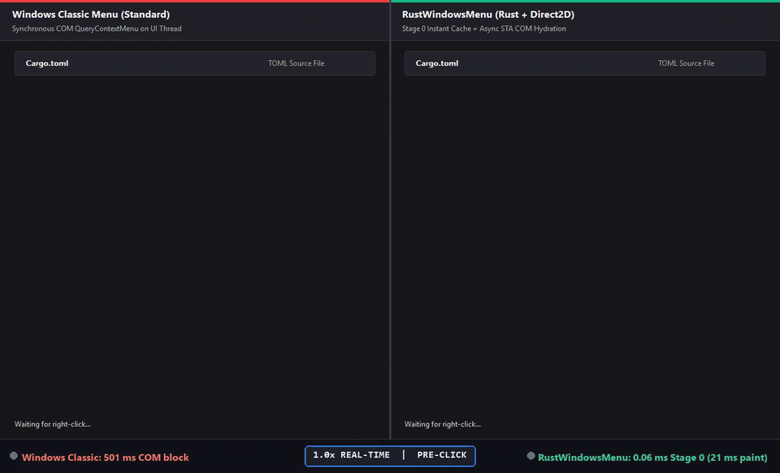

# RustWindowsMenu (`rwm`) v0.4.1

[English](README.md) | **日本語**



高画質 60 fps MP4: [docs/demo.mp4](docs/demo.mp4)

> 実ファイル `Cargo.toml` での `0.25x` スロー再生比較 (OS 標準・MSIX・COM 全 27 項目 / 右ボタン押下 100 ms / 中央カウントダウン `3 -> 2 -> 1 -> CLICK!`): 初回クリック (Cold) では Windows 標準が **`389.534 ms`** (`query_ms = 346.143 ms`) かかるのに対し、`rwm` v0.4.1 (ホバー先読みキャッシュ) は全 27 項目を **`25.799 ms`** で表示します (**`15.1x` 高速**、通常 2 回目以降の Warm `86.786 ms` 比でも **`3.4x` 高速**)。

---

## RustWindowsMenu とは

Windows 11 のエクスプローラーでファイルを右クリックすると、COM ハンドラや MSIX 拡張の初期化が終わるまで UI スレッドが同期ブロックされ、メニューが開くまで一瞬固まります。**RustWindowsMenu (`rwm`)** は、既存の右クリック項目を 1 つも削らずに構築処理を UI スレッドの外へ逃がします。

- **OS ネイティブ項目を 100% 維持:** Windows 標準コマンド、MSIX (`IExplorerCommand`)、従来の COM シェル拡張項目をすべてそのまま表示します。
- **オフスレッド投機キャッシュ (`ABI v3`):** ホバー・選択変更・`t=0 ms` 右クリック時に `rwm-host.exe` の専用 STA スレッドで先読み構築し、ロックフリー共有メモリ経由で即時表示します。
- **GUI 管理画面 & トレイアイコン内蔵 (`rwm ui`):** 右クリックメニューまたはタスクトレイから、項目の表示/非表示や遅いサードパーティ拡張の無効化を GUI で直接切り替えられます。
- **安全・非破壊で元に戻せる設計:** エクスプローラーのフォルダビューとデスクトップ (`SHELLDLL_DefView`) のみにインプロセス連携し、`explorer.exe` を自動再起動せず、`uninstall.bat` または `rwm uninstall` できれいに復元できます。

---

## クイックインストール

### 方法 A: リリース ZIP を使う (推奨)

1. [GitHub Releases](https://github.com/yebisu0529-ship-it/RustWindowsMenu/releases/latest) から `RustWindowsMenu-v0.4.1-x86_64-pc-windows-msvc.zip` をダウンロードし、`SHA256SUMS.txt` で SHA-256 ハッシュを確認します。
2. ZIP を展開し、**`install.bat`** (または `powershell -ExecutionPolicy Bypass -File .\install.ps1`) を実行します。
   - アップグレード時も `%APPDATA%\RustWindowsMenu\config.toml` (`hidden_items` を含む) は保持されます。
   - アンインストールする場合は **`uninstall.bat`** (または `rwm uninstall`) を実行してください。

### 方法 B: ソースからビルドする

Windows 11 上に Rust ツールチェーン (`MSVC` ターゲット) が必要です。

```powershell
cargo build --release --workspace
.\target\release\rwm.exe install
```

導入後の状態確認と環境ベンチマーク:

```powershell
rwm status
rwm doctor
rwm bench C:\Windows\notepad.exe --runs 5
rwm optimize C:\Windows\notepad.exe
```

補足: 既定の `rwm install` は Windows 11 の標準コンテキストメニュー設定を変更しません。Windows 10 スタイルのクラシックメニューをレジストリで有効にしたい場合のみ、`--classic` を付けてインストールするか、以下を実行してください。

```powershell
rwm classic enable --restart
```

---

## 主な機能

### 1. 右クリック管理 GUI (`rwm ui` / `rwm-host.exe --ui`)

エクスプローラーの右クリック最下部にある **「メニューをカスタマイズ (RWM)...」** / **Customize Menu (RWM)...**、`rwm-host.exe` のタスクトレイアイコン左クリック、または `rwm ui [PATH] [--background]` から開けます。

- **表示するメニュー項目タブ:** コマンドやサブメニュー単位で表示/非表示をチェックボックスから切り替え (`verb:...` / `label:...` 形式で `config.toml` の `hidden_items` に保存)、ライブ検索、不要になった区切り線の自動整理、プレビュー確認、投機キャッシュへの即時反映 (`RustWindowsMenu.ConfigReload.v3`) に対応しています。
- **シェル拡張 (高速化) タブ:** ハンドラごとの実測クエリ遅延 (`ms`) を可視化し、遅いサードパーティ拡張 (`>= 25 ms`) を強調表示し、1 クリックまたは一括で無効化/再有効化できます (Windows 標準ハンドラ変更時は確認ダイアログを表示)。
- **動作設定タブ:** 各種機能フラグのトグル、ホスト / ABI 稼働状態の確認、`config.toml` の表示・初期化を行えます。
- Windows 11 ダーク/ライトテーマ追従 (`DWMWA_USE_IMMERSIVE_DARK_MODE`)、Per-Monitor DPI v2、単一インスタンス制御、タスクトレイメニュー (左クリックで管理画面を開く、右クリックで管理画面を開く・右クリック拡張の有効化/無効化・RWM ホスト終了) を備えています。

### 2. 専用 STA 投機キャッシュ (`rwm-host.exe` + `rwm_hook.dll`)

[`RustWTM`](https://github.com/RustWTM/RustWTM) のような超低オーバーヘッドな Rust デスクトップツールの設計を取り入れ、メニュー列挙をエクスプローラーの UI スレッドから分離しています。

- **共有メモリ IPC (`ABI v3`):** `Local\RustWindowsMenu_Cache_v3` (`CACHE_MAGIC = 0x5257_4D33`) 上に PID 管理スロットロック (異常終了時の復旧対応)、Seqlock 付き `PrefetchSlot` (16 KB)、`ShowSlot`、8 エントリの `ReadySlot` (`0.0010 us` / ヒープ確保 0 回判定) を配置しています。
- **多段階プリフェッチ:** ホバー静止 (既定 `120 ms` / `LVM_HITTEST`, `IFolderView`, `AccessibleObjectFromPoint`)、選択変更 (`80 ms` デバウンス集約)、`WM_RBUTTONDOWN` (`t=0 ms`) で自動先読みを実行します。
- **ローカルパス限定・安全なフォールバック:** 仮想項目・UNC パス・`DRIVE_REMOTE` 共有は事前構築の対象外としてネットワークドライブの不要な接続・スリープ解除を防ぎ、前提条件を満たさない場合はエクスプローラー標準メニューへ即座にフォールバックします。
- **二重表示・消え残り防止:** 透過 `1x1` レイヤードポップアップオーナー (`WS_EX_LAYERED | WS_EX_TOOLWINDOW`, `LWA_ALPHA = 0`) でフォアグラウンドを適切に取得し、フォーカス喪失監視タイマー、非フォアグラウンド時のスコープ限定フック、`RustWindowsMenu.CancelMenu.v3` + `host_tracking` ビットで同時表示や消え残りを防ぎます。

### 3. 遅延シェル拡張の診断 (`rwm optimize`)

Microsoft 製システム DLL (`!is_system_module`) を除外した上でハンドラごとの実クエリ時間を計測し、ボトルネックになっているサードパーティ拡張を特定します。既定は dry-run で、HKCU `Shell Extensions\Blocked` へ書き込む場合のみ `--apply` を指定します。

---

## 実測ベンチマーク (v0.4.1)

OS 標準項目、MSIX パッケージ動詞、有効なサードパーティ COM シェル拡張を 100% 保持した実環境での計測値です。

### エンドツーエンド画面収録 (`demo_capture`, `Cargo.toml`, 100 ms 長押し, 27 項目)

| モード | クエリ時間 | ボタンを離した後の初回メニュー表示 | 表示項目数 | 高速化倍率 |
|---|---:|---:|---:|---:|
| Windows 標準 (Warm / 2 回目以降) | `59.754 ms` | `86.786 ms` | 27 | `1.0x` |
| Windows 標準 (Cold / 初回クリック・DLL 読み込みあり) | `346.143 ms` | `389.534 ms` | 27 | `1.0x` |
| **RWM v0.4.1 (`--cached` / ホバー先読み)** | `362.166 ms` (UI 外で事前構築) | **`25.799 ms`** | **27** | **`3.4x` Warm / `15.1x` Cold** |

未ホバー右クリック (`--mode rwm`) の `demo_capture` 測定では、`100 ms` のボタン押下中にバックグラウンドクエリ (`55.316 ms`) が完了しました。

### CLI ベンチマーク (`rwm bench --runs 5`, v0.3.0 ベースライン)

| 対象 | Cold Root | Warm Root (p50 / p95) | Warm Query (p50 / p95) | Eager Submenu | 100 ms 保持時 `t=0 ms` (p50 / p95) |
|---|---:|---:|---:|---:|---:|
| ファイル (`Cargo.toml`, 12 MSIX) | `471.853 ms` | `150.736 / 154.707 ms` | `149.594 / 153.645 ms` | `33.853 ms` | `50.736 / 54.707 ms` |
| フォルダ (`crates`, 12 MSIX) | `424.078 ms` | `138.249 / 227.754 ms` | `137.033 / 226.723 ms` | `5.555 ms` | `38.249 / 127.754 ms` |
| フォルダ背景 (`--background`, 2 MSIX) | `232.517 ms` | `24.425 / 61.109 ms` | `23.621 / 59.359 ms` | `165.002 ms` | **`0.000 / 0.000 ms`** |

ホバー/選択の投機キャッシュヒット時、シェル待機時間は **`0.000 ms`** (`IPC handoff 0.0000 ms`) です。

### ゼロアロケーション Hotpath 計測 (`hotpath_cost --release`)

[crates/rwm-core/tests/hotpath_cost.rs](crates/rwm-core/tests/hotpath_cost.rs) の独自 `GlobalAlloc` カウンタによる計測結果:

| 処理 | 所要時間 | ヒープ確保 |
|---|---:|---:|
| `SelectionKey::matches (fast_eq)` | `0.0263 us` | `0.00 allocs` |
| `SelectionKey::cache_key_hash` | `0.0797 us` | `0.00 allocs` |
| `SharedCacheClient::is_ready` | `0.0010 us` | `0.00 allocs` |
| `WarmDllPin::probe_module_bytes` | `13.8445 us` | `0.00 allocs` |
| Map 参照 (`FastHasher` vs `SipHash`) | `1.50 ns/op` vs `6.15 ns/op` | `0.00 allocs` |

---

## リリースハイライト

- **v0.4.1 (ポップアップフォーカス制御・二重表示修正・IPC / インストーラー強化):** `1x1` 透過レイヤードオーナー、フォーカス監視、非フォアグラウンド時のスコープ限定フック、`CancelMenu.v3` によりメニューの消え残り・同時表示を解消。PID 管理スロットロック、シーケンス検証付き `ClaimShow`、対象検証付きの「名前の変更 (`Protocol::EditLabel`)」、構文エラー時の `config.toml` 上書き保護、`install`/`uninstall` 時の `--ui` クローズ、v0.1 設定の自動バックアップ移行 (`config.v01.bak.toml`)、アンインストール時の `current.json` および親ディレクトリのリパースポイント検証を実装しました。
- **v0.4.0 (管理 GUI とトレイアイコン):** 右クリックの **「メニューをカスタマイズ (RWM)...」**、`rwm ui`、3 タブ構成のダーク/ライト対応ネイティブ Win32 GUI、区切り線自動整理、シェル拡張の計測・ブロック、`rwm-host.exe` トレイ常駐を追加しました。
- **v0.3.0 (投機キャッシュ基盤と最適化):** `rwm-host.exe` の Menu STA スレッド (`CacheCore`: LRU + TTL + クリップボード変更検知)、共有メモリ `ABI v3`、ホバー/選択/`t=0 ms` プリフェッチ、`FastHasher`、`WarmDllPin`、デスクトップシェル経由の常駐起動 (`IShellDispatch2::ShellExecute`)、`rwm optimize`、`Shell_TrayWnd` 経由のエクスプローラー再起動を実装しました。

---

## CLI リファレンス

```text
rwm install [--classic] [--no-startup] [--no-path] [--no-start]
rwm uninstall [--purge]
rwm start | stop | run
rwm status [--json]
rwm doctor [PATH] [--background] [--json]
rwm inspect [PATH] [--background] [--extended] [--json]
rwm bench [PATH] [--background] [--runs N] [--json]
rwm optimize [PATH] [--background] [--threshold-ms MS] [--apply] [--json]
rwm preview [PATH] [--background] [--extended] [--no-animation] [--raw]
rwm ui [PATH] [--background] [--wait]
rwm handlers list [--json] | block <CLSID> [--name LABEL] | unblock <CLSID> [--force] | reset
rwm classic status [--json] | enable [--restart] | disable [--force] [--restart]
rwm config path | show | init [--force] | reset
```

---

## 設定ファイル (`config.toml`)

設定ファイルは `%APPDATA%\RustWindowsMenu\config.toml` に保存されます。各項目の説明は [config.example.toml](config.example.toml) を参照してください。

```toml
enabled = true
prebuild_on_rbuttondown = true
arm_delay_ms = 15
no_animation = true
pin_handler_dlls = true
max_pinned_dlls = 32
classic_menu_fallback = false
debug_logging = false
hover_prebuild = true
hover_delay_ms = 120
selection_prebuild = true
host_menu_cache = true
host_cache_entries = 6
host_cache_ttl_ms = 8000
show_customize_entry = true
hidden_items = []
```

---

## 安全性と動作範囲

- システムバイナリを変更せず、エクスプローラーのフォルダビューとデスクトップ (`SHELLDLL_DefView`) のみにインプロセスでフックします。
- `install` / `uninstall` の実行中に `explorer.exe` を自動再起動しません。
- **緊急停止スイッチ (Kill Switch):** `%LOCALAPPDATA%\RustWindowsMenu\DISABLE_HOOK` に空ファイルを作成すると、アンインストールせずに即座にフックをバイパスできます。
- アンインストール削除の前に所有マニフェスト (`current.json`) と親ディレクトリのリパースポイントを厳密に検証します。
- 状態や IPC の前提条件が一致しない場合は、ただちにエクスプローラー標準のコンテキストメニューへフォールバックします。

## ライセンス

[MIT License](LICENSE)
