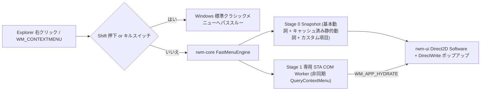

# RustWindowsMenu (`rwm`)

**Windows 11 のクラシック右クリックメニューを Rust で爆速化するオープンソースツール**

*An ultra-fast Windows 11 classic-density right-click menu accelerator written in Rust (Stage 0 Instant Cache + Direct2D/DirectWrite + Async STA COM Hydration).*

[](LICENSE)


▶ **[60fps HD デモ動画を見る (`docs/demo.mp4`)](docs/demo.mp4)** — 左: 標準の Windows クラシックメニュー（`500.7 ms` COM ブロッキング / 表示まで `525.6 ms`） / 右: RustWindowsMenu（Stage 0 `0.057 ms` / 初回描画 `21.5 ms` → バックグラウンドで COM 拡張を順次ハイドレーション）

---

## 特徴 / Highlights

- **Stage 0 即時スナップショット (`< 0.1 ms` warm)** — 基本操作（開く / ターミナルで開く / 切り取り / コピー / パスのコピー / ショートカットの作成 / 削除 / 名前の変更 / プロパティ）と静的レジストリ動詞（事前キャッシュ済み）を即座に構築します。
- **非同期 STA COM ハイドレーション** — 7-Zip、PowerRename、File Locksmith、Open With、Flect、新規作成 (`New`) などの通常メニュー項目を**すべて表示したまま**、専用の温存 STA スレッドで `IContextMenu::QueryContextMenu` を非同期実行して開いているメニューへ逐次反映します。
- **Direct2D + DirectWrite カスタム描画 (`GDI` フォールバック付き)** — Windows 11 のライト/ダーク自動追従、角丸 (`DWMWA_WINDOW_CORNER_PREFERENCE`)、高 DPI スケーリング、`classic` / `compact` / `comfortable` 密度切り替え、キーボード/ニーモニックナビゲーションに対応。
- **安全第一の Explorer フック設計** — `rwm_hook.dll` は `explorer.exe` スレッドのみに限定（他プロセスにはアタッチ直後に不活化）、PE ヘッダー / CodeView フィンガープリント照合によるビルド不整合ガード、パニック捕捉サーキットブレーカー、`Shift+右クリック` ネイティブフォールバック、キルスイッチファイル、非破壊なレジストリバックアップ/復元を備えています。

---

## 実測ベンチマーク / Measured Benchmarks

環境: **Windows 11 26H2 (Build 26300, x86_64)** / 対象 PC 上の実在 COM シェル拡張群で計測（`cargo build --release --workspace`）

### 1. 実ウィンドウ右クリック計測 (`examples/demo_capture`, `Cargo.toml`)

| 計測対象 | 内訳・方式 | 実測値 |
|---|---|---|
| **Windows クラシック標準 (`TrackPopupMenuEx`)** | UI 取得 `21.335 ms` + 同期 `QueryContextMenu` `479.328 ms` (合計 COM `500.674 ms`) | 表示まで **`525.649 ms`** |
| **RustWindowsMenu (Stage 0 + Direct2D Software + Async COM)** | Stage 0 スナップショット `0.057 ms` (`57 us`) / D2D 初回ウィンドウ描画完了まで | 表示まで **`21.479 ms`** |

### 2. プロファイラ CLI (`rwm bench`)

| 対象 | レジストリ事前キャッシュ構築 (`engine prewarm`) | Stage 0 (初回 / ウォーム) | 同期 COM 拡張合計 | Stage 0 速度比 vs 同期 COM |
|---|---:|---:|---:|---:|
| **単一ファイル (`Cargo.toml`)** | `12.667 ms` | `3.495 ms` / **`0.016 ms`** (`13` 項目) | `238.362 ms` (`20` ハンドラ) | **14,898.6x** |
| **フォルダ背景 (`--background`)** | `12.422 ms` | `10.384 ms` / **`0.015 ms`** (`21` 項目) | `338.975 ms` (`7` ハンドラ) | **22,599.3x** |

<details>
<summary>主な COM ハンドラ別の実測内訳（実環境測定値）</summary>

| 対象 | ハンドラ名 | 状態 | 追加項目数 | 実測時間 (ms) |
|---|---|---|---:|---:|
| ファイル | `DaemonShellExtImageLite` | ok | 2 | 86.032 |
| ファイル | `Open With` | ok | 5 | 51.039 |
| ファイル | `FileSyncEx` (OneDrive) | failed | 0 | 34.528 |
| ファイル | `EPP` (Windows Defender) | empty | 0 | 30.523 |
| ファイル | `Sharing` / `SendTo` / `ModernSharing` | ok/empty | 2 | 16.330 |
| ファイル | `7-Zip` / `Flect` / `FileLocksmithExt` / `PowerRenameExt` | ok | 43 | 7.671 |
| フォルダ背景 | `New` (新規作成) | ok | 14 | 284.121 |
| フォルダ背景 | `FileSyncEx` / `PowerRenameExt` / `Sharing` | ok/empty | 2 | 44.649 |

</details>

---

## アーキテクチャ / Architecture



ワークスペース構成:
- [`crates/rwm-core`](crates/rwm-core): レジストリ静的動詞キャッシュ、Win11 クラシックメニュー切替（バイト単位バックアップ/復元）、COM STA ワーカー、アイコン抽出、TOML 設定、ベンチマーク。
- [`crates/rwm-ui`](crates/rwm-ui): Direct2D Software レンダラー（GDI フォールバック、`WM_PRINTCLIENT` 対応）、角丸・DPI・スクロール・キーボード操作・非同期ハイドレーション統合。
- [`crates/rwm-hook`](crates/rwm-hook): `explorer.exe` 専用 `WH_CALLWNDPROC` + `SetWindowSubclass` インターセプター (`rwm_hook.dll`)。
- [`crates/rwm-cli`](crates/rwm-cli): `rwm.exe`（環境診断・ベンチ・プレビュー・クラシック切替・フックホスト・インストール管理）。

---

## クイックスタート / Quick Start

### 1. リリース版の入手またはソースビルド

[GitHub Releases](https://github.com/yebisu0529-ship-it/RustWindowsMenu/releases) から `RustWindowsMenu-v0.1.0-x86_64-pc-windows-msvc.zip` をダウンロードして展開するか、ソースからビルドします。

```powershell
git clone https://github.com/yebisu0529-ship-it/RustWindowsMenu.git
cd RustWindowsMenu
cargo build --release --workspace
```

### 2. 環境チェックと速度計測（レジストリ・Explorer 無変更）

```powershell
# 前提条件のセルフチェック（Windows 11 / Direct2D / Hook DLL ABI / HKCU 書込テスト）
.\target\release\rwm.exe doctor

# 現在のクラシックメニュー状態や Hook DLL 状態を確認
.\target\release\rwm.exe status

# 指定ファイル・フォルダ背景の COM ハンドラ別遅延をプロファイル
.\target\release\rwm.exe bench .\Cargo.toml
.\target\release\rwm.exe bench . --background

# 実 Direct2D ポップアップを単体でプレビュー（Explorer へのフックなし）
.\target\release\rwm.exe preview .\Cargo.toml --timings
```

### 3. Explorer アクセラレータの導入・起動・停止

```powershell
# インストール（クラシックメニュー有効化 + MenuShowDelay 最適化 + %LOCALAPPDATA%\RustWindowsMenu\bin へ配置）
# --autostart を付けるとサインイン時に `rwm run --hidden` を自動起動
.\target\release\rwm.exe install --autostart

# フォアグラウンドでホストを起動（Ctrl+C または別端末の `rwm stop` で安全にデタッチ）
rwm run

# バックグラウンド実行中のホスト（--hidden 含む）を停止してフック解除
rwm stop

# 完全に元へ戻す（自動起動削除・ホスト停止・ファイル削除・クラシックメニュー状態を復元）
rwm uninstall
```

クラシックメニューの切替だけを使いたい場合はフックなしでも利用できます。

```powershell
rwm classic enable --restart-explorer
rwm classic disable --restart-explorer
```

---

## 設定 (`config.toml`)

`rwm config init` で `%APPDATA%\RustWindowsMenu\config.toml`（環境変数 `RWM_CONFIG` で上書き可）にデフォルト設定を生成できます。見本は [`config.example.toml`](config.example.toml) を参照してください。

```toml
[appearance]
theme = "auto"         # "auto" | "dark" | "light"
density = "classic"    # "compact" | "classic" | "comfortable"
show_icons = true
show_shortcuts = true
show_timings = false
corner_radius = 6

[behavior]
shift_bypass_to_native = true
enable_async_com_hydration = true
show_loading_footer = true
terminal_command = 'wt.exe -d "{dir}"'

[handlers]
default_policy = "inline"   # 既定では通常どおり全項目をそのまま表示
submenu_title = "拡張メニュー"

[handlers.overrides]
# 特定の重い・不要な COM ハンドラだけを名前または CLSID で制御可能
# DaemonShellExtImageLite = "submenu"
# "{CB3D0F55-BC2C-4C1A-85ED-23ED75B5106B}" = "disabled"

# [[custom_items]]
# label = "Open in VS Code"
# command = "code"
# args = ['"{path}"']
# scopes = ["file", "folder", "background"]
```

---

## 安全設計 / Safety & Recovery

- **Explorer 限定インジェクション**: `rwm_hook.dll` はプロセス末尾が `\explorer.exe` の場合のみサブクラスを張ります。
- **PE ビルド不整合ガード**: Explorer が古いビルドの `rwm_hook.dll` をピン留めしたままアップグレードされた場合、`rwm run` は対象プロセスのマップ済み PE フィンガープリントを検査し、不一致なら `SetWindowsHookExW` を拒否して Explorer 再起動を案内します。
- **即座にバイパス**:
  - 右クリック時に `Shift` キーを押しながらクリックすると Windows 標準メニューへフォールバックします。
  - `%LOCALAPPDATA%\RustWindowsMenu\DISABLE_HOOK` ファイルを作成する（キルスイッチ）か、`rwm stop` を実行すると即座に無効化/デタッチされます。
- **非破壊なレジストリ復元**: `rwm classic enable` 前の値・型（および未設定だったキー）を `classic_backup.json` へ保存し、`disable` / `uninstall` で正確に原状回復します。

---

## FAQ: Chrome 等ブラウザ上でも動きますか？

- **Web ページやタブの右クリックメニュー**は Chromium 独自の UI（`RenderViewContextMenu`）で描画されるため、Win32 シェルメニューや Windows レジストリ (`{86ca1aa0-...}`) の管理対象外です。
- 一方、**Chrome の「名前を付けて保存」「ファイルを開く」ダイアログ内での右クリック**は Windows 共通コモンダイアログ (`#32770` / `SHELLDLL_DefView`) を使うため、`rwm classic enable` によるクラシックメニュー化がそのまま効きます。`rwm_hook.dll` 自体は v0.1.0 では安定性優先のため `explorer.exe` プロセス限定としています。

---

## License

[MIT License](LICENSE)
