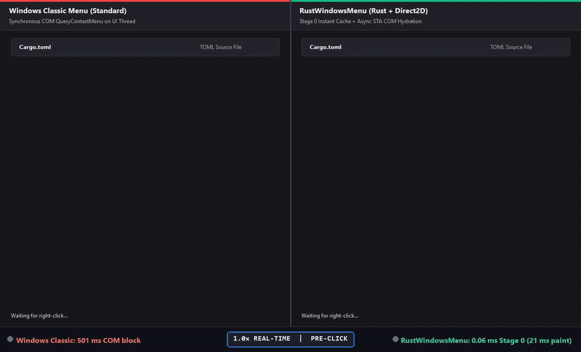
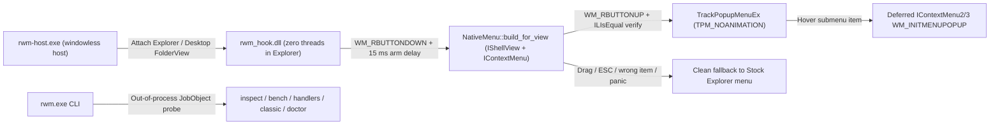

# RustWindowsMenu (`rwm` v0.2.0)

[](https://github.com/yebisu0529-ship-it/RustWindowsMenu/releases/tag/v0.2.0)
[](#)
[-orange)](#workspace-architecture)

**Time-shifted native Windows context menus for Windows 11.**
`rwm` v0.2.0 eliminates perceived right-click stall in Windows Explorer and on the Desktop by building the real OS `IContextMenu` during your `WM_RBUTTONDOWN` hold and popping it on `WM_RBUTTONUP` with `TPM_NOANIMATION`.

> **v0.2.0 architectural reset:** `rwm` no longer replaces Explorer menus with a custom Direct2D UI (`rwm-ui` has been removed). Every item comes straight from the OS Shell (`IShellView::GetItemObject` + `IContextMenu2` / `IContextMenu3`), so OS verbs, Win11 MSIX packaged apps, third-party `shellex` handlers, SendTo, View/Sort/Group, Recycle Bin, and virtual folders appear intact.



Watch full 60 fps MP4 capture: [docs/demo.mp4](docs/demo.mp4)

---

## 日本語サマリー (Japanese Overview)

Windows 11 の右クリックメニューが遅い原因は描画 UI ではなく、`WM_RBUTTONUP` を待ってから同期的に数十個の COM / MSIX シェル拡張を初期化してクエリする構造にあります。

**RustWindowsMenu v0.2.0 のアプローチ:**

1. **Time-Shifted Prebuild (先行構築):** `WM_RBUTTONDOWN` を押してから `15 ms` のアーム遅延後にバックグラウンドではなく同じ選択対象に対して `IContextMenu::QueryContextMenu` を先行開始します (`prebuild_on_rbuttondown = true`)。
2. **100% OS ネイティブメニュー:** 独自描画 (`rwm-ui`) を廃止し、`IShellView` が返す本物の `HMENU` と `IContextMenu2` / `IContextMenu3` を `TrackPopupMenuEx(TPM_NOANIMATION)` で表示します。MSIX アプリ動詞、PowerToys、7-Zip、送り先、ごみ箱、仮想フォルダまで設定不要でそのまま動作します。
3. **安全設計と診断 CLI:** `explorer.exe` 内にスレッドを増やさず、`ILIsEqual` で選択一致を検証し、サブメニューはホバー時まで遅延初期化します。さらに `rwm inspect` / `rwm bench` が別プロセス＋ジョブオブジェクト監視で遅いシェル拡張を特定し、`rwm handlers block` で安全に無効化できます。

---

## Measured performance (Windows 11 26H2)

All numbers below were measured directly on Windows 11 26H2 (build 26300) using `demo_capture` and `rwm bench`.

### Side-by-side capture (`Cargo.toml`, 100 ms button hold, 30 native items)

| Capture run | Shell query | Items | Time to menu after `WM_RBUTTONUP` | Notes |
|---|---|---|---|---|
| Stock Windows capture | `137.163 ms` | 30 | `157.162 ms` | Queries only after button release |
| `RWM v0.2.0` capture | `135.173 ms` | 30 | `75.331 ms` | `2.1x` faster perceived response after release |

### CLI benchmark (`rwm bench --runs 5`, out-of-process isolated probe)

| Target | Cold root | Warm root p50 / p95 | Eager submenu delta | Perceived remaining after 100 ms hold (p50 / p95) |
|---|---|---|---|---|
| File (`Cargo.toml`, 20 handlers, 12 MSIX verbs) | `654.883 ms` | `202.120 ms` / `221.159 ms` | `35.042 ms` | `117.120 ms` / `136.159 ms` |
| Directory background (`--background`, 2 MSIX verbs) | `235.997 ms` | `26.073 ms` / `110.669 ms` | `176.631 ms` | `0.000 ms` / `25.669 ms` |

`rwm inspect Cargo.toml` identified the main extension bottleneck on the test machine: `DaemonShellExtImageLite Class` (`{1D1B5D7B-0FC9-452E-902C-12BACD4FBC20}`) took `108.915 ms` cold (`95.475 ms` warm). Blocking a single slow handler drops warm file menus toward instantaneous open.

---

## How it works



Key design invariants:

- **Zero background threads inside `explorer.exe`.** All hooking runs synchronously inside the FolderView subclass on the UI thread with rotating timer guards and a sticky panic breaker.
- **Deferred submenu initialization.** Only the root popup is populated during right-button hold (`CMF_EXPLORE | CMF_CANRENAME`). Submenus such as `7-Zip` or `Open with` initialize only when hovered (`WM_INITMENUPOPUP`), avoiding eager work for unused trees.
- **Exact selection verification.** Before displaying a prebuilt menu on `WM_RBUTTONUP`, `rwm` compares live selection PIDLs against the captured snapshot via `ILIsEqual`. If you dragged or changed selection, the prebuilt menu is discarded and Explorer handles the click normally.
- **Safe handler pinning.** `WarmDllPin` pins slow COM handler DLLs (`GetModuleHandleExW` with `PIN` semantics up to `max_pinned_dlls`) to stop repeated `LoadLibrary` / `CoFreeUnusedLibraries` thrashing.
- **Crash-proof host synchronization.** `rwm-host.exe` monitors Explorer and Desktop windows with a hidden top-level `WS_OVERLAPPED` window (to catch `TaskbarCreated` on Explorer restarts) and respects integrity level matching and `abi_version` validation.

---

## Quick start

### Option 1: Portable Release ZIP (recommended)

1. Download `RustWindowsMenu-v0.2.0-x86_64-pc-windows-msvc.zip` from [GitHub Releases](https://github.com/yebisu0529-ship-it/RustWindowsMenu/releases/tag/v0.2.0).
2. Extract the archive and double-click `install.bat` (or run `install.ps1` in PowerShell).

The installer copies `rwm.exe` and `rwm-host.exe` to `%LOCALAPPDATA%\RustWindowsMenu\bin`, stages versioned `versions\<BUILD_ID>\rwm_hook_<BUILD_ID>.dll` + `current.json`, adds `bin` to User `PATH`, registers Startup (`HKCU\...\Run`), strips Zone.Identifier (MOTW), and launches `rwm-host.exe` silently with no console window.

Optional first-run setup flags (when calling `rwm.exe install` directly):

- `rwm install --classic` also enables the classic context menu registry key in `HKCU` (optional; `rwm` intercepts Explorer directly either way).
- `rwm install --no-startup` skips adding `rwm-host.exe` to Windows Startup.
- `rwm install --no-path` skips adding the `bin` folder to User `PATH`.

To remove cleanly later, run `uninstall.bat` (or `rwm uninstall --purge`). Uninstall verifies `current.json` ownership and rejects reparse points before deleting files.

### Option 2: Build from source

Prerequisites: Windows 10/11 x64 and the Rust MSVC toolchain (`cargo`, stable).

```powershell
git clone https://github.com/yebisu0529-ship-it/RustWindowsMenu.git
cd RustWindowsMenu
cargo build --release --workspace
.\target\release\rwm.exe install
```

---

## CLI reference

All diagnostics run out-of-process with a timeout and Windows Job Object cleanup so broken third-party shell extensions cannot hang your terminal.

```text
rwm install [--classic] [--no-startup] [--no-path] [--no-start]
rwm uninstall [--purge]
rwm start | stop | run
rwm status [--json]
rwm doctor [PATH] [--background] [--json]
rwm inspect [PATH] [--background] [--extended] [--json]
rwm bench [PATH] [--background] [--runs N] [--json]
rwm preview [PATH] [--background] [--extended] [--no-animation]
rwm handlers list [--json]
rwm handlers block <CLSID> [--name LABEL]
rwm handlers unblock <CLSID> [--force]
rwm handlers reset
rwm classic status [--json]
rwm classic enable [--restart]
rwm classic disable [--force] [--restart]
rwm config path | show | init [--force] | reset
```

Typical workflow to diagnose a slow right-click:

```powershell
# 1. Verify runtime health, host process, ABI match, and native probe
rwm doctor

# 2. Rank every COM handler and MSIX verb by real query milliseconds
rwm inspect C:\path\to\file.txt

# 3. Preview the exact native OS menu in a test harness window
rwm preview C:\path\to\file.txt

# 4. Block a bad third-party handler using standard Windows HKCU Shell Extensions\Blocked
rwm handlers block {1D1B5D7B-0FC9-452E-902C-12BACD4FBC20}
```

---

## Configuration

Config lives at `%APPDATA%\RustWindowsMenu\config.toml`. Run `rwm config init` to generate it from the schema in [config.example.toml](config.example.toml):

```toml
# Enable or disable time-shifted native context menus.
enabled = true

# Start building the native IContextMenu while the right mouse button is held.
prebuild_on_rbuttondown = true

# Delay in milliseconds after WM_RBUTTONDOWN before prebuild starts (prevents drag misfires).
arm_delay_ms = 15

# Suppress the fade-in animation on TrackPopupMenuEx.
no_animation = true

# Pin slow shell extension DLLs in memory to reduce repeated LoadLibrary overhead.
pin_handler_dlls = true
max_pinned_dlls = 32

# Optional classic menu fallback flag (false by default).
classic_menu_fallback = false

# Write diagnostic hook events to %LOCALAPPDATA%\RustWindowsMenu\logs\.
debug_logging = false
```

---

## Safety, bypass shortcuts, and v0.1 upgrade notes

- **Instant bypass:** Hold `Ctrl + Shift + Right-Click` in Explorer to bypass `rwm` completely and let Explorer build its own menu for that click.
- **Extended verbs:** Hold `Shift + Right-Click` (or pass `--extended` to `inspect` / `preview`) to invoke standard extended OS verbs.
- **Emergency kill switch:** Create an empty file at `%LOCALAPPDATA%\RustWindowsMenu\DISABLE_HOOK`. Active hooks stop intercepting on the next click without restarting Explorer or running the uninstaller.
- **Manifest-verified cleanup & classic backup restore:** `rwm classic enable` / `disable` manages `HKCU\Software\Classes\CLSID\{86ca1aa0-34aa-4e8b-a509-50c905bae2a2}` with verified JSON backups and corrupt-backup protection unless `--force` is passed. Upgrading from `v0.1.0` automatically removes stale `bin\rwm_hook.dll` files and restores legacy `MenuShowDelay` backup metadata safely.

---

## Workspace architecture

| Crate | Purpose |
|---|---|
| [`crates/rwm-core`](crates/rwm-core) | Native OS shell menu builder (`IShellView` / `IContextMenu2` / `IContextMenu3`), `ILIsEqual` verification, deferred submenu handling, `WarmDllPin`, MSIX / COM handler enumeration, `Shell Extensions\Blocked` management, classic menu backup/restore, config, and build ID fingerprinting (`abi_version = 2`). |
| [`crates/rwm-hook`](crates/rwm-hook) | Thread-free `ShellTabWindowClass` / Desktop FolderView subclass (`rwm_hook.dll`), mouse gesture state machine (`WM_RBUTTONDOWN` + `15 ms` arm timer -> prebuild -> `WM_RBUTTONUP`), drag/TTL cancellation, kill switch check, and deferred detach cleanup. |
| [`crates/rwm-cli`](crates/rwm-cli) | `rwm.exe` CLI (`install`, `uninstall`, `status`, `doctor`, `inspect`, `bench`, `preview`, `handlers`, `classic`, `config`), windowless `rwm-host.exe` background host, out-of-process Job Object probe harness, and `examples/demo_capture.rs`. |
| [`scripts`](scripts) | One-click `install.bat`, `install.ps1`, and `uninstall.bat` (CRLF normalized via `.gitattributes`). |

## License

[MIT](LICENSE)
